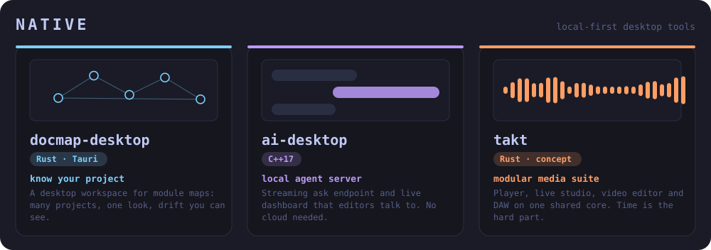
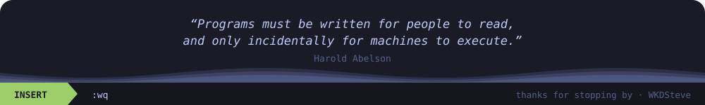

<p align="center"></p>

<p align="center">
  <a href="https://wkdsteve.github.io/wkd/"></a>
  <a href="https://github.com/WKDSteve?tab=repositories&q=.nvim"></a>
  <a href="https://www.linkedin.com/in/stefan-bartl"></a>
  <a href="mailto:l.value.impl@gmail.com"></a>
</p>

<p align="center"><sub><a href="#the-nvim-family">the family</a> · <a href="#native">native</a> · <a href="#in-numbers">numbers</a> · <a href="#whoami">whoami</a></sub></p>

## Hi, I'm glad you're here

I live in **Neovim** and build for it: a family of small, tested, documented plugins that share one foundation (`lib.nvim`), plus **local-first desktop tools** next to them. Based in Vienna; CLI tools, web development and security are the rest of the day. Languages I reach for: Lua, TypeScript, Rust, Go, C++, and sometimes Zig or Lisp.

Everything is built with the same habits: one command per plugin (`:Git`, `:File`, `:Pickers` ...), no hidden shell calls, specs that fail without the fix, and docs that are checked by CI. The [**wkd site**](https://wkdsteve.github.io/wkd/) reads the plugin repositories themselves and shows them as a Neovim window (still growing, already pretty).

## The .nvim family

<p align="center"></p>

<details>
<summary><b>AI & context</b> &nbsp;<sub>2 plugins</sub></summary>

<br>

| plugin | what it does |
|---|---|
| [**ai.nvim**](https://github.com/WKDSteve/ai.nvim) | Provider-agnostic AI layer for Neovim: streaming ask/chat, context assembly, and a Neovim-native UI on top of lib.nvim |
| [**buffer-ctx.nvim**](https://github.com/WKDSteve/buffer-ctx.nvim) | Buffer context for Neovim - insert or copy path, module, timestamp, UUID, annotations, and boilerplate from the current buffer, plus a unified :Format and :Mark... |

</details>

<details>
<summary><b>Editing</b> &nbsp;<sub>7 plugins</sub></summary>

<br>

| plugin | what it does |
|---|---|
| [**cascade.nvim**](https://github.com/WKDSteve/cascade.nvim) | Context-aware lists & word cycling for Neovim - continue, renumber, checkboxes, rotate, sort, indent/move, with native fallbacks. No Treesitter, standalone. |
| [**replacer.nvim**](https://github.com/WKDSteve/replacer.nvim) | Project-wide search-and-replace with ripgrep, an interactive picker (fzf-lua or Telescope), live preview, and precise, bottom-up application of changes. |
| [**emojis.nvim**](https://github.com/WKDSteve/emojis.nvim) | Remove, count, list, replace, or insert emojis in Neovim across line/visual/buffer/project scopes. |
| [**language.nvim**](https://github.com/WKDSteve/language.nvim) | Spelling, grammar, and translation tooling for Neovim: one plugin, unified scope model, async throughout |
| [**markdown.nvim**](https://github.com/WKDSteve/markdown.nvim) ⭐3 | Self-contained Markdown toolkit for Neovim - heading nav/shift, TOC, folding, GFM tables, link/anchor/image handling, and highlight fixes. FileType-scoped, no... |
| [**data.nvim**](https://github.com/WKDSteve/data.nvim) | Format and filter JSON/YAML/XML in Neovim: pretty/compact/lines/keys, buffer/selection/register scope. |
| [**migrate.nvim**](https://github.com/WKDSteve/migrate.nvim) | Migrate deprecated Neovim API calls (nvim_*_option, vim.notify) in place - line, range, buffer, or cwd, with a Telescope picker. |

</details>

<details>
<summary><b>Files & navigation</b> &nbsp;<sub>8 plugins</sub></summary>

<br>

| plugin | what it does |
|---|---|
| [**gopath.nvim**](https://github.com/WKDSteve/gopath.nvim) | A modular file-navigation plugin for Neovim. Resolves symbols, require() paths, and arbitrary file references via a multi-phase pipeline: LSP -> Treesitter ->... |
| [**hover.nvim**](https://github.com/WKDSteve/hover.nvim) | Rest the cursor on a path or link and see what it points at: file heads, directory listings, images, PDF pages, markdown sections, URL details -- with every preview... |
| [**open.nvim**](https://github.com/WKDSteve/open.nvim) | Open files, URLs, and paths from anywhere in Neovim - to the system default app, browser, file manager, or a split/tab. |
| [**pickers.nvim**](https://github.com/WKDSteve/pickers.nvim) | Unified fuzzy-picker plugin for Neovim - one :Pickers command over telescope.nvim or fzf-lua, with scopes, collections and directory navigation. |
| [**filetree.nvim**](https://github.com/WKDSteve/filetree.nvim) | Adapter-agnostic filetree features for Neovim - one feature set across neo-tree, nvim-tree, netrw & more, opt-out by default. |
| [**fileops.nvim**](https://github.com/WKDSteve/fileops.nvim) | Unified :File command for Neovim - create, rename, move, duplicate, delete, and cycle files via libuv, cross-platform, no shell. |
| [**sessions.nvim**](https://github.com/WKDSteve/sessions.nvim) | Branch- and project-aware Neovim sessions, built on lib.nvim - save/restore/rename, statusline component, session picker |
| [**neotree-fs-refactor.nvim**](https://github.com/WKDSteve/neotree-fs-refactor.nvim) | Automatic require()/import reference updates for Neo-tree file renames and moves |

</details>

<details>
<summary><b>Debug & inspect</b> &nbsp;<sub>10 plugins</sub></summary>

<br>

| plugin | what it does |
|---|---|
| [**dap.nvim**](https://github.com/WKDSteve/dap.nvim) | Config layer on top of nvim-dap: adapters & launch configs for 9 languages, batteries included |
| [**debugging.nvim**](https://github.com/WKDSteve/debugging.nvim) | One :Debug command for every Neovim debugging tool |
| [**diff.nvim**](https://github.com/WKDSteve/diff.nvim) | Flexible :Diff command for Neovim - compare buffers, files, or the clipboard, side-by-side or inline, via vim.diff (no shell calls). |
| [**lsp.nvim**](https://github.com/WKDSteve/lsp.nvim) | Umbrella plugin for a Neovim config's whole LSP setup: server registry, attach pipeline, formatter and diagnostics toggles, a declarative catalogue for every LSP... |
| [**insights.nvim**](https://github.com/WKDSteve/insights.nvim) | Project analysis for Neovim - symbol index, code metrics, file tree, imports, and compression in one unified command. |
| [**runtime-analysis.nvim**](https://github.com/WKDSteve/runtime-analysis.nvim) | Runtime truth for Neovim plugins: an HTTP request runner, opt-in call/argument telemetry, and live package.loaded inspection, paired with documentation.nvim's static... |
| [**recommender.nvim**](https://github.com/WKDSteve/recommender.nvim) | Analyzes the current Lua buffer for repeated dotted chains and suggests local alias declarations in an interactive floating window. |
| [**spotlight.nvim**](https://github.com/WKDSteve/spotlight.nvim) | Persistent multi-token highlighting for Neovim: spotlight any number of words, IDs, IPs or error codes in distinguishable colors - matchadd-based, so cost is... |
| [**cmdlog.nvim**](https://github.com/WKDSteve/cmdlog.nvim) ⭐5 | A lightweight Neovim plugin to interactively view, search, and reuse command-line mode (`:`) and shell history using Telescope with extras. |
| [**testing.nvim**](https://github.com/WKDSteve/testing.nvim) | Test runner and orchestration layer for Neovim plugins, built on lib.nvim (pre-alpha skeleton) |

</details>

<details>
<summary><b>Project & repos</b> &nbsp;<sub>6 plugins</sub></summary>

<br>

| plugin | what it does |
|---|---|
| [**sandbox.nvim**](https://github.com/WKDSteve/sandbox.nvim) ⭐6 | Manage your containers (Podman, Docker, and more) directly from Neovim – with clean architecture, pluggable backends, and a TUI-native experience. |
| [**github_stats.nvim**](https://github.com/WKDSteve/github_stats.nvim) | Automatic collection and analysis of GitHub repository traffic statistics for Neovim, with an interactive dashboard, exports, and period comparisons. |
| [**reposcope.nvim**](https://github.com/WKDSteve/reposcope.nvim) | Search, preview, and clone GitHub, GitLab, and Codeberg repositories directly from inside Neovim. Modular, minimal, Telescope-inspired interface. |
| [**docmap.nvim**](https://github.com/WKDSteve/docmap.nvim) | know your project - an interactive module map, drift checks that fail CI, and an in-editor browser for any repository. |
| [**gitsuite.nvim**](https://github.com/WKDSteve/gitsuite.nvim) | One :Git command tree for everything git in Neovim -- own implementation where it pays off, thin adapters where it doesn't. |
| [**terminal.nvim**](https://github.com/WKDSteve/terminal.nvim) | Named, per-project terminals in Neovim: toggle a float/split/tab, send text, run commands with quoted argv. Backends: native, WezTerm panes, tmux; status export and... |

</details>

<details>
<summary><b>View & render</b> &nbsp;<sub>6 plugins</sub></summary>

<br>

| plugin | what it does |
|---|---|
| [**ui.nvim**](https://github.com/WKDSteve/ui.nvim) | Statusline, tabline and theme layer for Neovim - the frame around the window. Planning stage. |
| [**color_my_ascii.nvim**](https://github.com/WKDSteve/color_my_ascii.nvim) ⭐7 | A Neovim plugin for colorful highlighting of ASCII art in Markdown code blocks with automatic language detection, custom highlights, and predefined color schemes. |
| [**images.nvim**](https://github.com/WKDSteve/images.nvim) | Show images inside Neovim via the iTerm2 protocol (OSC 1337) - hover, gallery, clipboard paste. Works on native Windows where Kitty-protocol plugins cannot. |
| [**mdview.nvim**](https://github.com/WKDSteve/mdview.nvim) ⭐3 | Highly secure, high-performance browser-based Markdown preview for Neovim - Go relay server + Rust/WASM sanitized rendering, no Node.js required. |
| [**media.nvim**](https://github.com/WKDSteve/media.nvim) | What is in this media file, and one picture of it -- ffprobe metadata and ffmpeg poster frames/contact sheets for Neovim |
| [**pdfport.nvim**](https://github.com/WKDSteve/pdfport.nvim) | Extract and display PDF content in Neovim via pluggable extraction backends (pdftotext, pdfplumber, marker, docling, Claude, Ollama) and renderers. |

</details>

<details>
<summary><b>Foundation</b> &nbsp;<sub>1 plugin</sub></summary>

<br>

| plugin | what it does |
|---|---|
| [**lib.nvim**](https://github.com/WKDSteve/lib.nvim) ⭐3 | Reusable Lua/Neovim helper library - a tested, dependency-free base for personal plugins (lazy.nvim). |

</details>

## Native

<p align="center"></p>

Local web UIs and desktop apps that sit next to the editor plugins: [**takt**](https://github.com/WKDSteve/takt) (media suite, concept stage). More of them exist and stay private for now.

## In numbers

<p align="center"></p>

<sub>Counted from the public repositories by <code>scripts/update_data.py</code>: 40 plugins, 9,658 commits, 671,925 lines of Lua, 1,704 spec files.</sub>

## whoami

```ts
type Mood = "focused" | "curious" | "shipping";

const profile = {
  nickname: "lavalue",
  city: "Vienna",
  editor: "nvim" as const,
  mood: "shipping" as Mood,
  plugins: 40,
  languages: {
    lua: "plugins, scripting, the whole editor",
    rust: "desktop hubs and tools that must not break",
    typescript: "web UIs, the wkd site",
    go: "small servers and CLIs",
    cpp: "when control matters",
  },
  security: ["Wireshark", "HackRF One", "Metasploit", "firmware tools"],
  learning: ["architecture", "OS internals", "more Go"],
  chat: "Discord, happy to talk shop",
} as const;
```

> **One thing I care about:** access to technology should be a given for everyone, and it is not. Our data is collected daily, often without our knowledge. Transparency and control over how information is used are worth fighting for: [netzpolitik.org](https://netzpolitik.org), get organized!

<p align="center"></p>
